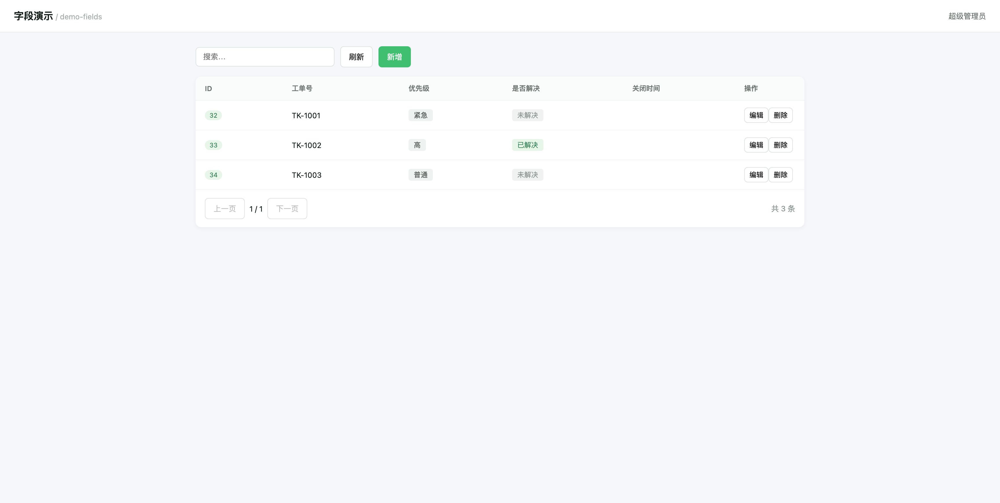
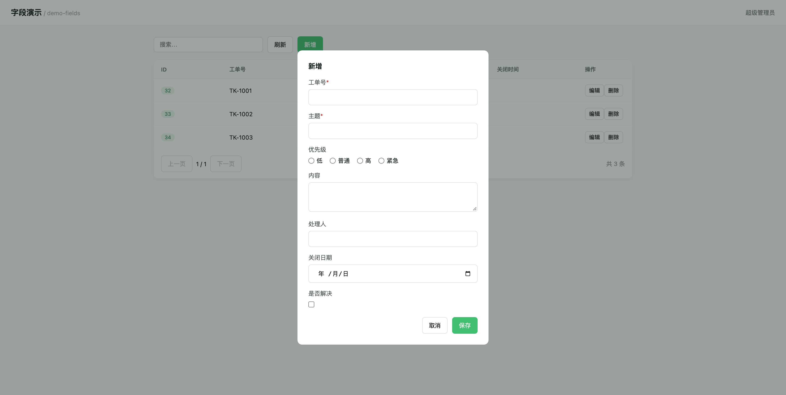
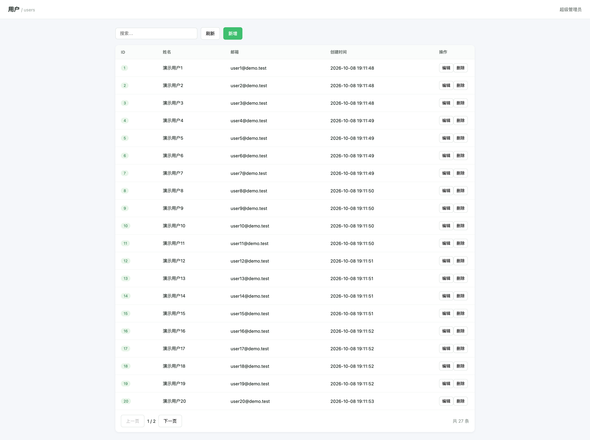

<div align="center">
  

# AI 码农 · Aimanong

> **Aimanong（AI 码农）后台开发框架** —— 让任何 AI Agent 在 5 分钟内理解框架、30 分钟内产出可运行的后台系统。
>
> **给有编程基础的程序员用：编码交给 AI，你负责需求、验收和方向。**

基于 **Laravel 12 + Vue 3**，专为 AI Agent 设计，同时为人类保留完整文档。

[](./CHANGELOG.md)
[](./LICENSE)
[](https://www.php.net)
[](https://laravel.com)

</div>

> 📜 **[项目宪法](./CONSTITUTION.md)** —— 本项目的最高指导文件（已于 2026-10-12 生效）。
> 需要理解「为什么这样设计」「什么改动会被拒绝」，读这一份就够了。

## 为什么叫 Aimanong

传统后台框架（dcat-admin、Filament 等）的使用者是人，追求灵活与优雅。
AI Agent 的需求完全不同：**低歧义、可自省、可验证、错误可自愈**。

> **人骑马，不跟马赛跑。**
> 承认人写不过 AI，然后让 AI 按人的意思写 —— 这是本项目存在的全部理由。

Aimanong 为此明确牺牲部分"灵活性"来换取"确定性"：

| 设计 | 目的 | 宪法条款 |
|---|---|---|
| 禁止方法重载、禁止嵌套闭包 | 降低 AI 生成歧义 | 第一条 AI 优先 |
| 一份声明 → Schema 编译出全部产物 | 消灭文档与实现漂移 | 第二条 声明唯一 |
| 自省 API + MCP Server | AI 无需"读文档"，直接调工具 | 第四条 可自省 |
| 错误带 `didYouMean` + 正确示例 | AI 一次改对 | 第六条 错误可自愈 |

## 使用者是谁

| 是 | 不是 |
|---|---|
| ✅ **有编程基础的程序员** | ❌ 完全不懂编程的人 |
| ✅ 会用命令行、装过 PHP 环境 | ❌ 连环境配置都不会的人 |
| ✅ 能看懂 AI 写了什么（但不亲自写） | ❌ 完全无法判断代码对错的人 |
| ✅ 用 AI 开发自己的 Web 系统 | ❌ 想拖拽建站的非技术人员 |

仍需要编程基础，因为你要能：装得起来、判断得了对错、在 AI 卡住时提供有效信息。

这不是低代码平台，也不是拖拽建站 —— 而是一个**被驯服好的、给 AI 用的后台框架**。
完整工作流见 [用 AI 开发你的后台](./docs/guide/ai-workflow.md)。

## 快速开始

**最新版本 v1.10.0** —— 全部里程碑（M0–M6）完成，
且已补齐「带地基的平台」六项基座能力（登录日志 / 操作日志 / 数据字典 /
文件上传 / 个人中心 / 管理员账号）。

经过 **6 轮 AI 实测**（一次成功率 0.5 → 0.5 → 1.0 → 1.0 → 1.0 → **1.0**）
与 **3 轮真实场景验证**（电商 / 插件 / CRM）。

> 修复记录见 [CHANGELOG](./CHANGELOG.md)（逐版本列出，含每次的验证方式）。
> 其中多个属于「界面看着正常、测试全绿」的类型，例如：
> 多对多关联写入从未生效、条件高亮从来没有视觉效果、
> 只读资源在 OpenAPI 里仍宣告写接口。
>
> 这类缺陷的共同点是：**只看代码和测试都发现不了，必须真机点一遍**。

```bash
composer require aimanong/framework
php artisan aimanong:install
```

详见 [CHANGELOG](./CHANGELOG.md)。

## 仓库结构

| 路径 | 说明 |
|---|---|
| `packages/framework` | 核心框架（Composer: `aimanong/framework`） |
| `packages/region` | 官方扩展：中国省市区三级联动 |
| `docs/` | 文档站（VitePress）+ Playground |
| `internal-docs/` | 开发文档：方案、实测记录、验证方法论 |
| `tests/e2e/` | 端到端测试（从零搭项目跑真实 HTTP） |
| `scripts/` | 发版检查、demo 一键搭建 |

> **前端没有独立包**：Aimanong 采用**零构建**方案 ——
> Vue 3 内置在框架里（不走 CDN），页面由 Schema 自动渲染，
> 使用者不需要 npm、不需要打包。这是刻意的取舍，
> 不是"还没做"。
>
> 曾经规划过的 `packages/ui`（npm `@aimanong/ui`）**已决定不做并删除**，
> 理由见 [决策分析](./internal-docs/packages-ui-决策分析.md)：
> 使用者零构建，npm 包到不了他们的运行时；真正需要「组件复用」的
> 是插件机制，那要的是**模板注入点**而不是组件包。

## 文档

- 📖 **[在线文档站](https://zyzyzzy.github.io/aimanong/)** —— 人读这个
- 🎮 **[Playground](https://zyzyzzy.github.io/aimanong/playground/)** —— 浏览器里改 Resource 声明，实时看四份产物
- 📝 **[AI 实测报告](https://zyzyzzy.github.io/aimanong/blog/ai-first-in-practice)** —— 六轮实测的缺陷与教训

> 本地预览：`cd docs && npm install && npm run dev`
- [llms.txt](./llms.txt) —— **AI 读这个**
- [AGENTS.md](./AGENTS.md) —— **AI Agent 项目内约定**
- [API 参考](./docs/api/) —— **由 Schema 自动生成**，永不漂移
- [开发计划](./internal-docs/开发计划.md) —— 里程碑与排期
- [AI 实测记录](./internal-docs/AI实测记录.md) —— 三轮实测的完整数据

> 文档站用法：
> ```bash
> cd docs && npm install
> npm run dev              # 本地预览
> npm run docs:gen         # 从 Schema 重新生成 API 参考
> npm run build            # 构建静态站点
> ```

## 状态

| 里程碑 | 状态 | 说明 |
|---|---|---|
| M0 地基 | ✅ **完成** | Laravel 12.69.3 实测：安装、认证、登录、会话全部跑通 |
| M1 Schema 编译层 | ✅ **完成** | 一份声明 → 四份产物，漂移检测可阻断 CI |
| M2 核心 DSL + Vue | ✅ **完成** | CRUD API + Schema 驱动渲染，浏览器实测通过 |
| M3 AI 能力层 | ✅ **完成** | 自省 API + MCP Server；AI 实测一次成功率 **1.0** |
| M4 字段与组件库 | ✅ **完成** | 30 个字段类型 + 10 个列展示器，浏览器实测通过 |
| M5 增强 | ✅ **完成** | 导出 / 树形 / 分步表单 / 插件系统 / 多应用 |
| M6 生态与文档 | ✅ **完成** | 文档站 / Playground / 代码生成器 / 实测报告 |

### M0 已交付

```
packages/framework/
├── src/
│   ├── AimanongServiceProvider.php   中间件组 / 路由 / 配置注入
│   ├── Auth/AdminGuard.php           GuardHelpers 实现
│   ├── Auth/AdminUserProvider.php    含 Laravel 11+ 新契约方法
│   ├── Http/Middleware/              Authenticate / Session / Bootstrap
│   ├── Http/Controllers/             Auth / Home
│   ├── Models/Administrator.php      Authenticatable 契约
│   ├── Registry.php                  Resource 注册表
│   └── Contracts/Resource.php
├── config/aimanong.php
├── database/migrations/              admin_users 表
├── resources/views/                  登录页 / 控制台
└── routes/admin.php
```

**Laravel 12 兼容性实测结论**：

- ✅ 安装命令用 `addProviderToBootstrapFile()` 正确写入 `bootstrap/providers.php`
- ✅ 认证链路：`attempt()` 成功 / 错误密码拒绝 / 会话保持
- ✅ HTTP 层：登录页 200、CSRF 生效（419）、登录后首页 200
- ✅ 已规避硬断点：`rehashPasswordIfRequired()`、`getAuthPasswordName()`、`redirectTo($request)`

### M1 已交付

```
packages/framework/src/Schema/
├── Compiler.php              声明 → AST 编译管道
├── Ast/                      ResourceNode / ColumnNode / FieldNode
└── Emitters/
    ├── JsonSchemaEmitter.php 前端运行时 Schema
    ├── TypeScriptEmitter.php 前端类型
    ├── OpenApiEmitter.php    REST 文档
    └── AiPromptEmitter.php   给 AI 读的上下文（本项目独有）
```

**四份产物由同一份声明编译，永不漂移**：

```bash
php artisan aimanong:schema           # 生成
php artisan aimanong:schema --check   # 漂移检测（漂移 exit=1 阻断 CI）
```

实测：改动声明后四份产物**同时**检出漂移；重新生成后恢复一致。
字段类型映射正确（`switch`→`boolean`、`number`→`number`）、22 项断言全绿。

AI 打错类型时会得到可自愈提示：`texte` → 建议 `text`。


### M6 已交付

| 交付物 | 说明 |
|---|---|
| **在线文档站** | [zyzyzzy.github.io/aimanong](https://zyzyzzy.github.io/aimanong/) —— API 参考由 Schema 自动生成，永不漂移 |
| **Playground** | [在线试玩](https://zyzyzzy.github.io/aimanong/playground/) —— 浏览器里改 Resource 声明，实时看四份产物 |
| **代码生成器** | `php artisan aimanong:make-resource {table} --label=中文 --register` |
| **五轮 AI 实测报告** | [对外发布版](https://zyzyzzy.github.io/aimanong/blog/ai-first-in-practice) —— 20 个缺陷 + 4 条教训 |

**代码生成器**一条命令从表到可用后台：

```bash
php artisan aimanong:make-resource suppliers --label=供应商 --register
```

> 与 MCP 工具 `scaffold-resource` **共用同一个生成器服务** ——
> 两条路径产出逐字节一致（实测 2138 bytes 相同），避免逻辑分叉。

### M5 已交付

| 功能 | 声明方式 | 关键设计 |
|---|---|---|
| **数据导出** | `$grid->export()` | 复用列表的搜索/排序逻辑，导出内容与界面一致；分批流式，大表不炸内存；UTF-8 BOM 防 Excel 乱码 |
| **树形结构** | Resource 实现 `tree()` | **循环引用检测**（A→B→A 返回 422 而非无限递归）；移动校验拒绝移到子孙下 |
| **分步表单** | `$form->step('标题')` | 用「当前步骤游标」而非嵌套闭包；字段归属由声明顺序决定 |
| **插件系统** | 继承 `Extension` | **依赖检查** + **失败隔离**（单个扩展出错不拖垮其它） |
| **多应用** | `config('aimanong.applications')` | 独立前缀/guard/用户模型；用 Laravel 12 Context 做请求级隔离 |

```php
// 导出：复用列表逻辑，导出内容与界面一致
$grid->export()->exportExcept(['cover_url']);

// 树形：循环引用会被检出，不会无限递归
public static function tree(Tree $tree): void
{
    $tree->parentColumn('parent_id')->titleColumn('name')->draggable();
}

// 分步表单：扁平声明，无嵌套闭包
$form->step('基本信息');
$form->text('name')->required();
$form->step('联系方式');
$form->email('email');
```

**插件系统实测**（失败隔离是重点）：

```
✅ 正常扩展启动
❌ needs-dep  缺少依赖: not-installed     ← 明确拒绝，非运行时崩溃
❌ broken     register() 失败: 模拟注册失败
→ 正常扩展未被前两者影响 = 失败已隔离
```

### M4 已交付

**字段类型：12 → 26 个**（Form 容器 30 个方法）

| 类别 | 字段类型 |
|---|---|
| 文本 | text · textarea · email · url · password · tel |
| 数值 | number · decimal · money · rate · slider |
| 选择 | select · multiselect · radio · checkbox · switch |
| 日期 | date · datetime · time · daterange |
| 其它 | color · icon · tags · hidden · display · divider |

**列展示器**（新增 6 个）：`bool()` · `badge()` · `money()` · `image()` · `link()` · `progress()`

**关键修复：前端渲染断层**

此前 12 个后端类型中，前端只处理了 4 类分支 —— `date`/`datetime`/`decimal`
等**声明了却渲染不出效果**。现已补齐：单选组、多选组、原生日期选择器、
小数步进、帮助文本、空值占位、语义标签配色。

**修复 AI 实测反馈的两个体验问题**：

1. 布尔列显示 `true`/`false` → 现渲染为「是/否」标签，且可自定义文案
2. `status` 类字段生成为 `text` → `scaffold_resource` 现按列名语义生成 `select` + `badge`

**scaffold_resource 增强**：
- 语义推断：数据库 `boolean` 类型优先，其次按列名（`is_`/`has_` 前缀、`_at` 后缀、金额/邮箱/电话关键词）
- 中文标签：120+ 精确映射 + 前缀组合（`user_name` → 「用户名」）





### M3 已交付

**自省 API**（`/__ai/*`，默认仅 local/debug，生产需 token）：

| 接口 | 用途 |
|---|---|
| `capabilities.json` | 完整能力清单（含反射出的每个字段类型特有方法） |
| `schema/{uri}` | Resource 完整定义 |
| `openapi.json` | 全量 API 文档 |
| `context` | Markdown 版 AI 上下文 |
| `examples/{pattern}` | 可复制代码片段 |
| `verify` | 声明校验入口 |

**MCP Server**（基于官方 [laravel/mcp](https://github.com/laravel/mcp) v0.4.2，stdio 协议已实测握手成功）：

`list_resources` · `describe_resource` · `scaffold_resource` · `create_page` · `validate_declaration` · `run_verify` · `query_data` · `search_docs`

**命令**：`php artisan ai:verify [resource] [--json]`

### ✅ AI 实测验收通过（三轮迭代）

按开发计划，M3 是**生死线**——必须验证「AI 能否顺畅使用」。
方法：启动完全不了解框架的 AI Agent，仅提供 `llms.txt` + MCP 访问权，
不给提示，令其独立完成任务；父 Agent 独立复核产出。

**三轮对比：**

| | 第一轮 | 第二轮 | 第三轮 |
|---|---|---|---|
| 一次成功率 | 0.5 | 0.5 | **1.0** |
| 框架纠错贡献 | 0% | 50% | **100%** |
| 是否读源码 | 读了 | 读了 | **没读** |
| 任务要求满足度 | 部分 | 7/7 | **7/7** |

**第三轮关键约束：明确禁止阅读框架源码。** 结果 AI 写代码阶段 **0 错误**，
首次校验即通过，且靠框架的错误信息定位了框架自身的缺陷。

**结论：AI 优先的设计假设成立。** 自省接口 + 可自愈错误 + requirements 校验器
足以支撑 AI 独立完成开发任务。

三轮共发现并修复 **11 个真实缺陷**（详见 [internal-docs/AI实测记录.md](internal-docs/AI实测记录.md)），
其中最重要的教训：

> **校验器只读元数据 = 假阳性工厂。**
> 任何「已设置」的断言，都必须有对应的运行时验证。

### M2 已交付

**用户只需写一个 Resource 类，即得到完整 CRUD 后台**（API + 页面）：

```
packages/framework/
├── src/Repository/EloquentRepository.php   数据源抽象（松耦合，可换 API/数组源）
├── src/Http/Controllers/ResourceController.php  通用 CRUD
└── resources/views/resource.blade.php      Vue 3 SPA 外壳
```

**核心特性：行为全部由 Schema 驱动**
- 可搜索列：从 `->searchable()` 推导，控制器零硬编码
- 校验规则：从 `->required()->max(255)` 推导，与表单声明永远一致
- 前端表格：列名/排序/格式化/分页全部来自 schema.json

**浏览器实测**（25 条真实数据）：

| 功能 | 结果 |
|---|---|
| 列表分页 | ✅ 共 27 条，2 页 |
| 快捷搜索 | ✅ "演示用户3" → 精确 1 条 |
| 列排序 | ✅ 点击 ID 表头出现 ↑ 指示 |
| 新增/删除 | ✅ 201 / 204 |
| 校验失败 | ✅ 422 精确到字段 |



## 基座能力（v1.6.0 起开箱即用）

传统后台框架只给你「画页面的工具」，登录、用户、权限、日志都得自己写。
Aimanong 从 v1.3.0 起转向「**带地基的平台**」，v1.6.0 补齐了 P0 六项 ——
**装完就有，一行代码都不用写**，每项都能用配置整体关掉。

| 能力 | 怎么用 | 关掉它 |
|---|---|---|
| **登录日志** | 自动记录成功与失败，无需声明 | `foundation.login_log.enable` |
| **操作日志** | 自动记录写操作（GET 不记），密码自动掩码 | `foundation.operation_log.enable` |
| **数据字典** | `$form->select('status')->dict('order_status')` | `foundation.dict.enable` |
| **文件上传** | `$form->image('cover')` / `->images()` / `->file()` / `->files()` | `foundation.upload.enable` |
| **个人中心** | 顶栏用户名即入口：改资料 / 改密码 / 我的权限 / 我的操作记录 | `foundation.profile.enable` |
| **管理员账号** | 内置 `admin-users` 资源：角色分配、启停用、最后登录 IP | `foundation.admin_user.enable` |

### 为什么这六项要连着做

它们是互相咬合的，拆开做等于把同一套接线做五遍：

```
管理员账号 ← 需要文件上传（头像）+ 角色关联
个人中心   ← 需要文件上传（头像）+ 操作日志（我的操作记录）
数据字典   ← 与其余几项共用一次「能力面三处接线」
```

### 这些能力对 AI 意味着什么

`GET /__ai/capabilities.json` 会明确告诉 AI：

- **数据对不上时先查 `admin-operation-logs`** —— 它是「谁在什么时候把哪条数据改成了什么」的唯一客观依据
- **项目里实际有哪些字典、哪些可选值** —— AI 不必翻代码猜「状态有哪些值」
- **哪些能力已经存在，不要重复造** —— 例如不要自己再建一张操作日志表

配套的 AI 能力面（`capabilities.json` / `search-docs` / `aimanong:docs` 三处）
由 `SingleSourceOfTruthTest` 锁死一致，新增能力漏接一处会直接测试失败。

## 许可

**MIT License** —— 允许免费商用，包括闭源商用。

| 你可以 | 你不可以 |
|---|---|
| ✅ 商用、修改、分发、闭源 | ❌ 用 "Aimanong" 命名你的 fork 或产品 |
| ✅ 用于公司内部系统 | ❌ 暗示官方背书 |

见 [LICENSE](./LICENSE)、[商标政策](./TRADEMARK.md)、[商业化说明](./COMMERCIAL.md)。

> **我们的承诺**：框架本体永久免费，不做社区版功能阉割；
> 收费的是**新增能力**（企业插件、托管服务、支持），不是把免费的东西锁起来。
